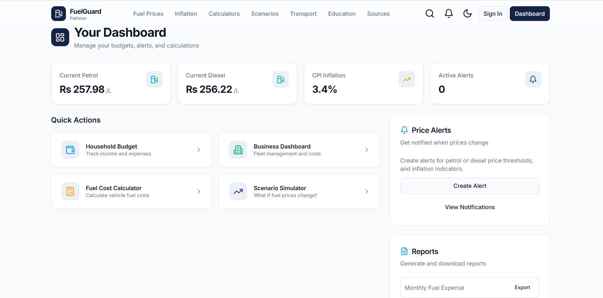
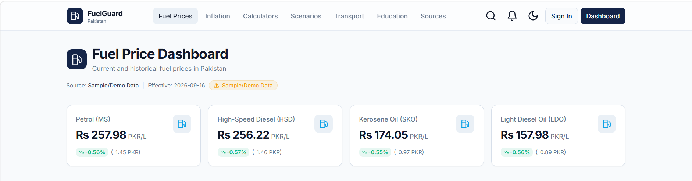
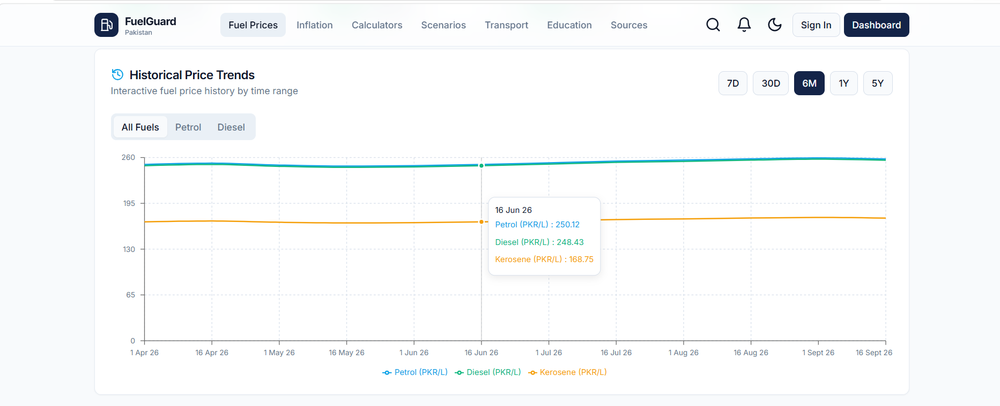
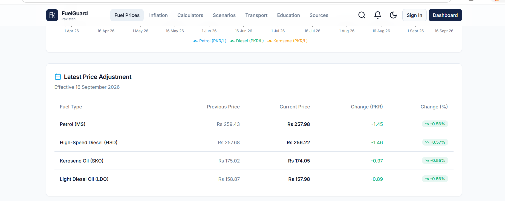
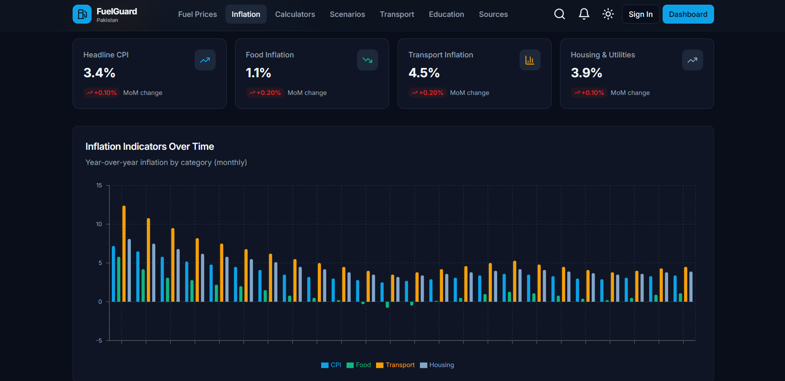
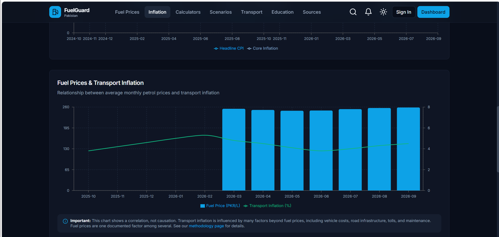
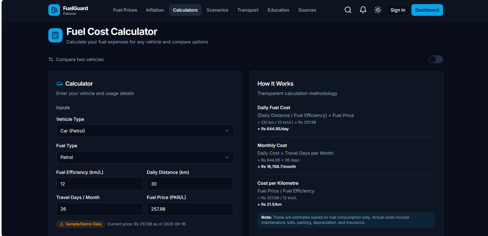
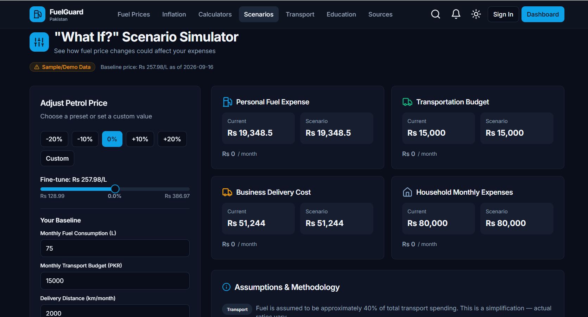
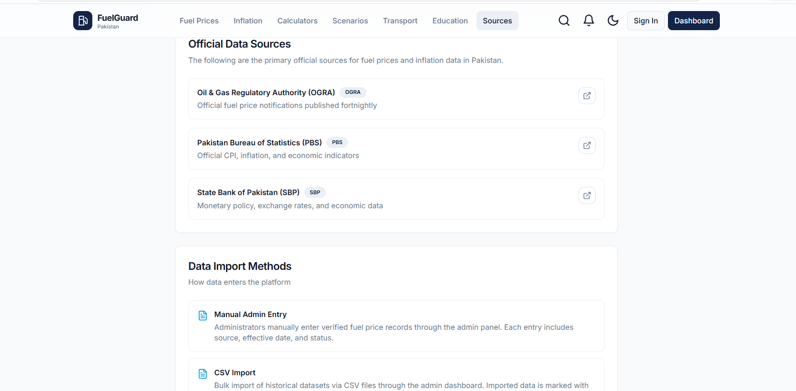
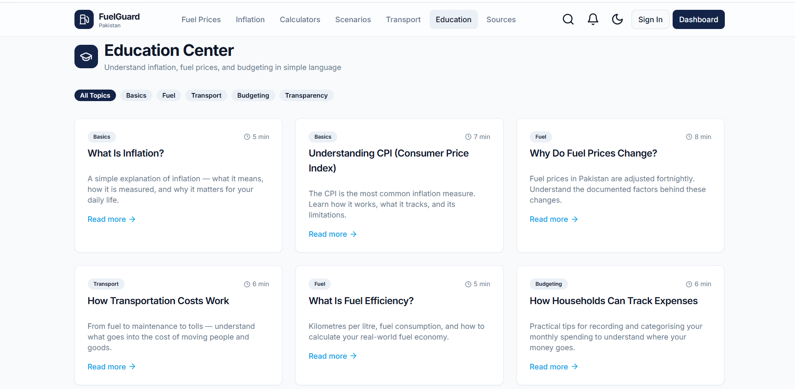

# FuelGuard Pakistan — Fuel & Inflation Analytics Platform

A modern web platform for exploring fuel prices, inflation trends, transportation expenses, and economic insights in Pakistan.

<p align="center">
  <a href="https://fuelguard-pakistan.vercel.app/">
    
  </a>
  <a href="https://github.com/seubaidraza-sir/fuelguard-pakistan">
    
  </a>
</p>

<p align="center">
  
  
  
  
  
</p>

---

## About the Project

**FuelGuard Pakistan** is a web-based analytics platform designed to help users explore fuel prices, inflation trends, transportation expenses, and budgeting scenarios in Pakistan.

Fuel price changes and inflation can affect everyday expenses, including commuting, transportation, and household budgeting. FuelGuard Pakistan brings related information and calculation tools together in one accessible interface.

The project focuses on presenting economic information through a modern dashboard, interactive tools, and easy-to-understand sections.

## Live Demo

- **Live Website:** https://fuelguard-pakistan.vercel.app/
- **GitHub Repository:** https://github.com/seubaidraza-sir/fuelguard-pakistan

---

## Key Features

- **Fuel Price Dashboard:** Explore fuel price information and available comparisons.
- **Inflation Insights:** Explore inflation-related information and economic trends.
- **Fuel Cost Calculator:** Estimate travel fuel expenses using user-provided information.
- **Transportation Analysis:** Explore transportation expenses and travel budgeting.
- **Economic Scenario Simulation:** Examine hypothetical changes in fuel costs.
- **Educational Resources:** Learn about fuel prices, inflation, and economic concepts.
- **Responsive Interface:** Navigate the platform through an organized web interface.

> **Data Transparency:** Some displayed figures use sample data. Figures should be treated as illustrative unless their source and update status are explicitly verified. The project does not claim that all displayed prices are automatically updated official figures.

---

## Project Screenshots

### 1. Main Dashboard

The main interface for exploring FuelGuard Pakistan.



### 2. Fuel Prices

Explore the fuel price interface and available price comparisons.







### 3. Inflation Insights

Explore inflation-related information and economic insights.





### 4. Fuel Cost Calculator

Estimate fuel expenses using the calculator.



### 5. Economic Scenarios

Explore hypothetical fuel price changes and their possible cost implications.



### 6. Data Sources

Explore the application's data source information.



### 7. Educational Resources

Explore educational content related to fuel prices and inflation.



---

## Technology Stack

| Technology | Purpose |
|---|---|
| Next.js | Web application framework |
| React | Component-based user interface |
| TypeScript | Type-safe JavaScript development |
| Tailwind CSS | Interface styling |
| Supabase client library | Backend integration capability |
| Git | Version control |
| GitHub | Source code hosting |
| Vercel | Website deployment |

*Backend capabilities depend on the corresponding configuration.*

---

## Getting Started

Follow these steps to run the project locally.

### Prerequisites

- Node.js
- npm
- Git
- Visual Studio Code or another code editor

### 1. Clone the Repository

```bash
git clone https://github.com/seubaidraza-sir/fuelguard-pakistan.git
```

### 2. Open the Project Directory

```bash
cd fuelguard-pakistan
```

### 3. Install Dependencies

```bash
npm install
```

### 4. Start the Development Server

```bash
npm run dev
```

### 5. Open the Application

Visit:

```text
http://localhost:3000
```

---

## Project Structure

The following is a simplified overview of the project.

```text
fuelguard-pakistan/
├── app/
├── lib/
│   └── sample-data/
├── public/
├── screenshots/
│   ├── dashboard.png
│   ├── fuel-prices.png
│   ├── fuel-prices1.png
│   ├── fuel-prices2.png
│   ├── inflation.png
│   ├── inflation1.png
│   ├── calculator.png
│   ├── education.png
│   ├── sources.png
│   └── scenarios.png
├── package.json
├── README.md
└── .gitignore
```

*This is a simplified illustration. Your actual project structure may contain additional files and folders.*

---

## Deployment

FuelGuard Pakistan is deployed on Vercel.

**Live Application:** https://fuelguard-pakistan.vercel.app/

The source code is hosted on GitHub. Updates pushed to the connected branch can trigger a new deployment.

---

## Future Improvements

Potential future improvements include:

- Integrating verified fuel price data sources.
- Documenting data sources and update timestamps.
- Expanding historical price comparisons.
- Improving economic data visualizations.
- Adding more budgeting scenarios.
- Enhancing accessibility and mobile usability.
- Expanding application testing.

These are proposed improvements and are not claims about features already implemented.

---

## Learning Outcomes

Developing this project provided practical experience with:

- Building a web application using Next.js and React.
- Developing reusable interface components.
- Working with TypeScript.
- Styling responsive interfaces.
- Managing source code with Git and GitHub.
- Building and testing a production deployment.
- Preparing a project for public presentation.

---

## Author

**Muhammad Ubaid Raza**

BS Software Engineering  
Institute of Data Sciences  
University of Engineering and Technology, Lahore

### Project Links

- **Live Website:** https://fuelguard-pakistan.vercel.app/
- **GitHub Repository:** https://github.com/seubaidraza-sir/fuelguard-pakistan

---

<p align="center">
  <b>FuelGuard Pakistan</b><br>
  Exploring Fuel Costs, Inflation, and Economic Insights in Pakistan
</p>